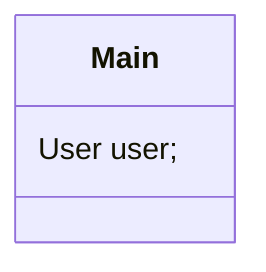

# Mermaid Compiler

Mermaid Compiler is a dependency-free Node.js preprocessor for Mermaid class
diagrams. It lets you split a large diagram into smaller files with import
directives, then generates one Mermaid file containing only the classes needed
by the entry diagram.

## Requirements

- Node.js 18 or newer

## Install globally

From a clone of this repository:

```sh
npm install -g .
```

This exposes the `mmdcompiler` command. The older `mmdcopiler` spelling is also
registered as a compatibility alias.

## Usage

```sh
mmdcompiler -i diagrams/main.mmd -o generated/diagram.mmd
```

The compiler runs once immediately and then keeps running, watching the entry
file and all of its imported files. The output is regenerated when a relevant
file changes.

To compile once and exit:

```sh
mmdcompiler -i diagrams/main.mmd -o generated/diagram.mmd --once
```

Useful options:

```text
-i, --input <file>       Entry Mermaid file
-o, --output <file>      Generated Mermaid file
    --once               Compile once and exit
    --watch              Keep watching (default)
    --debounce <ms>      Delay recompilation (default: 100)
-h, --help               Show help
-v, --version            Show the version
```

## Imports and dependency direction

Imports are written as Mermaid comments and are relative to the file containing
the import:



If `Main` depends on `User`, the compiler includes `User` and recursively
includes its dependencies. It does not traverse relationships backwards: if
`Admin --|> User`, `Admin` is not included just because `User` was included.
Unrelated classes in an imported file are also omitted.

The compiler also:

- resolves nested relative imports;
- detects circular imports and reports an error;
- gives definitions in the entry file precedence over imported duplicates;
- preserves the entry diagram's top-level Mermaid statements;
- follows common class relationships and class-member type references.

## Development

The project has no runtime dependencies. Run the native Node.js test suite with:

```sh
npm test
```

The project specification is in [docs/project description.md](docs/project%20description.md).
