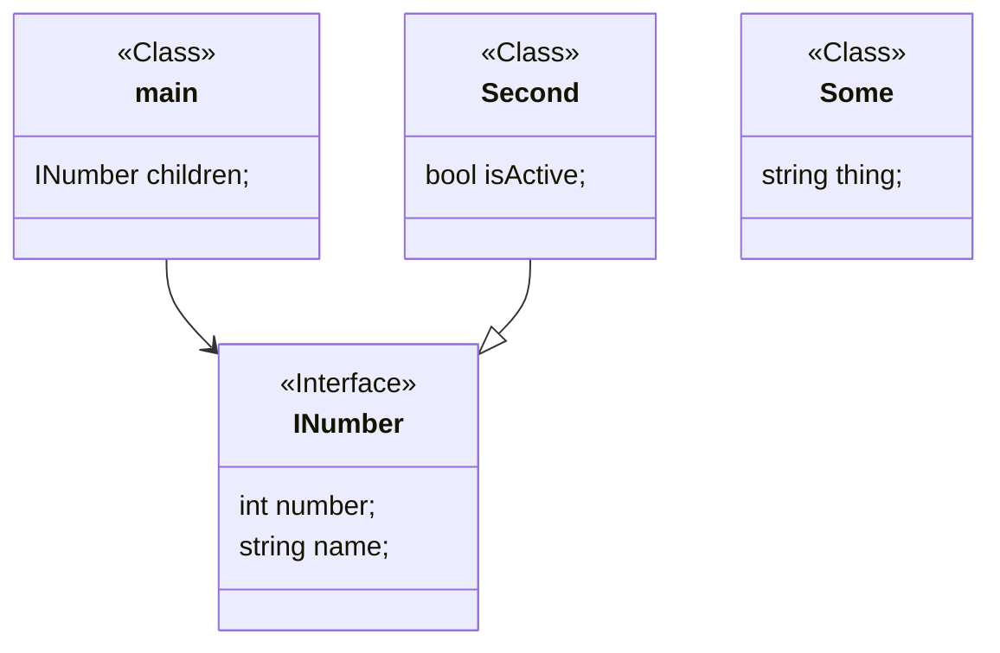
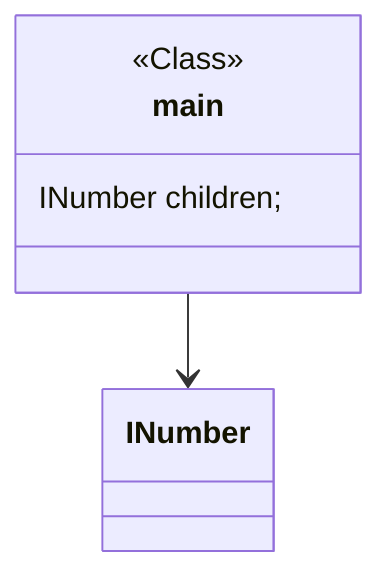
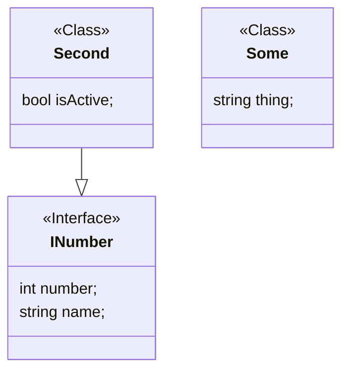
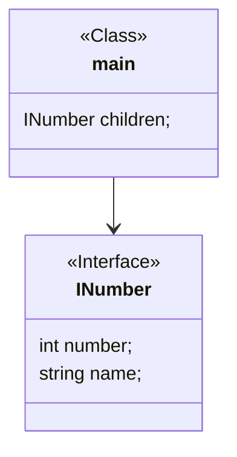

# Project description

This project is a new solution for mermaid code, its purpose is making diagramming
easier by allowing programmers to import classes in class diagrams, with this a
programmer will be better able to split a class diagram into smaller ones and
import the missing part from each other.

For example, imagine we have a very huge diagram this:

> > Of course this on is just a small diagram that we are using as an example.

We would be able to split that diagram into two parts:

First part:

Second part:

> > Lets imagine too that this diagram is in another file called secondMermaid.mmd

The result of these two diagrams should be a new file placed in a folder chosen
by the user. This new file should combine the main file with the classes it
depends on, and with the dependencies of those classes. The compiler must
follow relationships in the direction of the dependency. Since `main` depends
on `INumber`, `INumber` is included. `Second` is not included because it
depends on `INumber`; it is a dependent of `INumber`, not a dependency of
`main`. `Some` is unrelated and is not included either.

Therefore, compiling the first diagram should produce:

Keep in mind that the merging process must follow dependencies downwards and
never include dependents by traversing relationships backwards. If `A --> B`,
then `A` depends on `B`: starting from `A`, the compiler may include `B` and
any dependencies of `B`, but it must not include other classes that depend on
`B`.

You should know that the compiler must, localize the definitions of classes and
their relationship so it can put them in the merged file.

## Import Rules

The importing rules are simple:

- If a file has a definition of a class and that same class has a definition
  in the imported file, then the definition in the imported file must be ignored.

- If two files import each other, or with any other kind of cycle importation,
  the compilation must fail, with -1 error and notify the user about the problem.

- The importing path must be relative to the path of the importing file.

- Relationships must be followed in the direction of the dependency. If a
  class from the main diagram depends on an imported class, that imported class
  is included together with all of its dependencies. Classes that depend on the
  imported class are not included unless the main diagram depends on them
  directly or through another dependency.

## Importing direction

For a relationship `A --> B`, `A` depends on `B`. Compilation starts with
the classes and relationships in the entry file, then follows each relationship
from its dependent to its dependency. A class reached this way is included
together with its own dependencies. The compiler never follows an edge in the
opposite direction, so classes that depend on an included class are not pulled
into the result unless the entry diagram reaches them independently.
